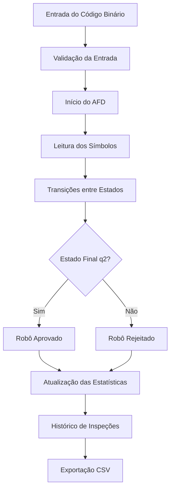

# AFD Factory — Fábrica de Robôs

<p align="center">
  
  
  
  
  
  
</p>

<p align="center">
  Simulador interativo de Autômato Finito Determinístico (AFD), desenvolvido com HTML, CSS e JavaScript, utilizando uma fábrica de robôs para demonstrar o reconhecimento de cadeias binárias.
</p>

---

## Sobre o Projeto

O **AFD Factory — Fábrica de Robôs** é um projeto acadêmico desenvolvido para a disciplina de **Linguagens Formais e Autômatos**, do curso de Ciência da Computação da Universidade Braz Cubas.

O projeto apresenta uma fábrica fictícia de robôs, na qual cada robô possui um código binário que precisa passar por uma inspeção automatizada.

A inspeção é realizada por um **Autômato Finito Determinístico (AFD)**, responsável por analisar os códigos e determinar se cada robô será aprovado ou rejeitado.

A regra utilizada é simples:

**Somente códigos binários que terminam em `01` são aceitos pelo sistema.**

A aplicação permite acompanhar visualmente as transições entre os estados do autômato, executar simulações e analisar os resultados por meio de um painel interativo.

---

## Objetivo do Projeto

O objetivo é demonstrar, de maneira visual e interativa, o funcionamento de um Autômato Finito Determinístico, aplicando conceitos de Linguagens Formais e Autômatos em uma simulação de fábrica automatizada.

O projeto permite estudar:

- Autômatos Finitos Determinísticos (AFD);
- linguagens formais;
- reconhecimento de cadeias binárias;
- estados e transições;
- estados iniciais e finais;
- processamento sequencial de símbolos;
- validação de cadeias aceitas e rejeitadas;
- visualização de algoritmos;
- testes automatizados;
- desenvolvimento web interativo.

---

## Funcionalidades

### Simulação de Fábrica de Robôs

A aplicação apresenta uma fábrica automatizada com elementos visuais, incluindo robôs, esteira transportadora, braços mecânicos e estação de inspeção.

Cada robô recebe um código binário que será analisado pelo autômato.

O resultado da inspeção determina se o robô será aprovado ou rejeitado.

---

### Validação de Códigos Binários

O usuário pode inserir códigos contendo apenas os símbolos:

```text
0 e 1
```

O sistema permite entradas de até 24 símbolos.

Exemplos:

| Código | Resultado |
|---|---|
| `01` | Aceito |
| `101` | Aceito |
| `001` | Aceito |
| `1101` | Aceito |
| `00001` | Aceito |
| `0` | Rejeitado |
| `1` | Rejeitado |
| `10` | Rejeitado |
| `11` | Rejeitado |
| `100` | Rejeitado |

---

### Execução Automática

O sistema permite executar a leitura completa de uma cadeia binária automaticamente.

O usuário também pode selecionar a velocidade da simulação:

- Lenta;
- Normal;
- Rápida.

Durante a execução, a aplicação apresenta o processamento dos símbolos e as mudanças de estado.

---

### Execução Passo a Passo

O usuário pode acompanhar cada transição do autômato individualmente.

Essa funcionalidade permite visualizar:

- o símbolo que está sendo processado;
- o estado atual;
- a transição realizada;
- o próximo estado;
- o percurso completo da cadeia.

---

### Diagrama Interativo do AFD

O projeto possui um diagrama visual dos estados do autômato.

Durante a execução, o sistema destaca o estado atual e a transição realizada.

Isso facilita a compreensão do funcionamento do algoritmo.

---

### Tabela de Transições

A aplicação apresenta a tabela de transições do AFD, destacando os estados e as entradas possíveis.

Essa tabela representa a função de transição utilizada durante o processamento.

---

### Painel de Desempenho

O projeto possui um painel que apresenta os resultados das inspeções.

Indicadores disponíveis:

- total de robôs inspecionados;
- quantidade de códigos aprovados;
- quantidade de códigos rejeitados;
- taxa de aprovação.

Os indicadores são atualizados conforme os testes são executados.

---

### Testes Automatizados

A aplicação possui uma bateria com 10 testes predefinidos.

Os testes verificam se o autômato classifica corretamente as cadeias binárias conforme a regra estabelecida.

O sistema registra os resultados e apresenta o histórico das inspeções.

---

### Histórico e Exportação CSV

O projeto armazena o histórico das inspeções realizadas durante a sessão.

Cada registro contém:

- identificação do robô;
- código binário analisado;
- percurso pelos estados;
- resultado da inspeção;
- data e hora.

Também é possível exportar os resultados para um arquivo CSV.

```text
afd-factory-historico.csv
```

---

## Tecnologias Utilizadas

| Tecnologia | Finalidade |
|---|---|
| HTML5 | Estrutura da aplicação |
| CSS3 | Estilização e animações da interface |
| JavaScript | Lógica do autômato e interatividade |
| SVG | Representação visual dos estados e transições |
| CSV | Exportação dos resultados das inspeções |
| Visual Studio Code | Ambiente de desenvolvimento |

---

## Estrutura do Projeto

```text
afd-factory-simulador-automatos/
│
├── index.html
├── styles.css
├── script.js
└── README.md
```

---

## Descrição dos Arquivos

### `index.html`

Arquivo responsável pela estrutura principal da aplicação.

Contém:

- página inicial;
- central de operações;
- campo de entrada dos códigos;
- interface da fábrica;
- diagrama do autômato;
- tabela de transições;
- painel de desempenho;
- bateria de testes;
- histórico das inspeções.

---

### `styles.css`

Arquivo responsável pela aparência visual da aplicação.

Inclui:

- layout da interface;
- estilização da fábrica;
- animações dos robôs;
- animação da esteira;
- destaque dos estados;
- indicadores de resultados;
- responsividade para diferentes dispositivos.

---

### `script.js`

Arquivo responsável pelo funcionamento do simulador.

Implementa:

- lógica do AFD;
- leitura das cadeias binárias;
- função de transição;
- validação das entradas;
- execução automática;
- execução passo a passo;
- atualização do diagrama;
- classificação dos resultados;
- estatísticas da sessão;
- testes automatizados;
- histórico das inspeções;
- exportação de arquivos CSV.

---

## Funcionamento do Autômato

O projeto utiliza um **Autômato Finito Determinístico (AFD)** para reconhecer cadeias binárias que terminam com `01`.

A linguagem reconhecida é:

```text
L = { w ∈ {0,1}* | w termina em 01 }
```

O autômato possui três estados:

| Estado | Descrição |
|---|---|
| q0 | Estado inicial |
| q1 | Estado que representa uma cadeia cujo último símbolo é 0 |
| q2 | Estado de aceitação, quando a cadeia termina em 01 |

### Tabela de Transições

| Estado | Entrada 0 | Entrada 1 |
|---|---|---|
| q0 | q1 | q0 |
| q1 | q1 | q2 |
| q2 | q1 | q0 |

O estado `q2` é o único estado de aceitação.

A cadeia será aceita somente se o processamento terminar nesse estado.

---

## Exemplos de Execução

### Código Aceito

Entrada:

```text
1101
```

Percurso:

```text
q0 → q0 → q0 → q1 → q2
```

Resultado:

```text
ACEITO
```

O código termina em `01`, portanto é reconhecido pelo autômato.

---

### Código Rejeitado

Entrada:

```text
1010
```

Percurso:

```text
q0 → q0 → q1 → q2 → q1
```

Resultado:

```text
REJEITADO
```

Embora o processamento passe pelo estado de aceitação `q2`, a cadeia termina no estado `q1`.

Por esse motivo, o código é rejeitado.

---

## Como Executar o Projeto

### 1. Clone o repositório

```bash
git clone https://github.com/mthxssoares/afd-factory-simulador-automatos.git
```

### 2. Acesse a pasta do projeto

```bash
cd afd-factory-simulador-automatos
```

### 3. Abra o projeto

Abra a pasta no Visual Studio Code.

### 4. Execute a aplicação

Abra o arquivo:

```text
index.html
```

Diretamente no navegador.

Também é possível utilizar a extensão **Live Server** do Visual Studio Code.

> Não é necessário instalar dependências, configurar banco de dados ou iniciar um servidor backend.

---

## Como Utilizar

1. Abra a aplicação no navegador.
2. Digite um código binário ou escolha um exemplo disponível.
3. Selecione a velocidade da simulação.
4. Clique em **Executar Produção** ou **Passo a Passo**.
5. Acompanhe as transições no diagrama.
6. Observe o resultado da inspeção.
7. Consulte o painel de desempenho.
8. Execute a bateria de 10 testes.
9. Exporte os resultados para CSV, se desejar.

---

## Fluxo do Projeto



---

## Testes do Projeto

A aplicação possui uma bateria de 10 testes com cadeias aceitas e rejeitadas.

| Cadeias Aceitas | Cadeias Rejeitadas |
|---|---|
| 01 | 0 |
| 101 | 1 |
| 001 | 10 |
| 1101 | 11 |
| 00001 | 100 |

Além da bateria de testes disponível na interface, o código JavaScript possui uma verificação interna das transições e dos exemplos utilizados no projeto.

---

## Possíveis Melhorias Futuras

Algumas melhorias que podem ser implementadas:

- Adicionar novos tipos de autômatos.
- Permitir a criação de regras personalizadas.
- Adicionar simulação de Autômatos Finitos Não Determinísticos (AFN).
- Criar novos exemplos de linguagens formais.
- Implementar testes com Jest.
- Adicionar novos gráficos estatísticos.
- Permitir exportação de relatórios em PDF.
- Adicionar mais animações ao ambiente da fábrica.
- Criar um tutorial interativo sobre AFD.

---

## Origem do Projeto

Este projeto foi desenvolvido para fins acadêmicos, como atividade da disciplina de **Linguagens Formais e Autômatos** do curso de Ciência da Computação da **Universidade Braz Cubas**.

A proposta foi representar visualmente o funcionamento de um Autômato Finito Determinístico por meio de uma fábrica de robôs, aplicando os conceitos estudados em sala de aula.

---

## Integrantes do Projeto

Projeto desenvolvido em grupo por:

- Gabriel Anastácio Pereira
- Karen Gabrielle Justino
- Marcos Antônio da Silva Souza
- Matheus Silva Soares
- Miguel da Silva Pereira

**Instituição:** Universidade Braz Cubas  
**Curso:** Ciência da Computação  
**Disciplina:** Linguagens Formais e Autômatos

---

## Uso Educacional

Este projeto possui finalidade acadêmica e educacional.

O conteúdo foi desenvolvido para estudo e demonstração prática de conceitos relacionados a Linguagens Formais, Autômatos Finitos Determinísticos, desenvolvimento web e simulação de algoritmos.
